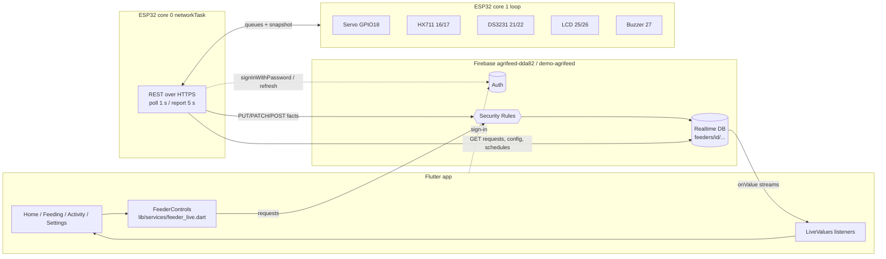
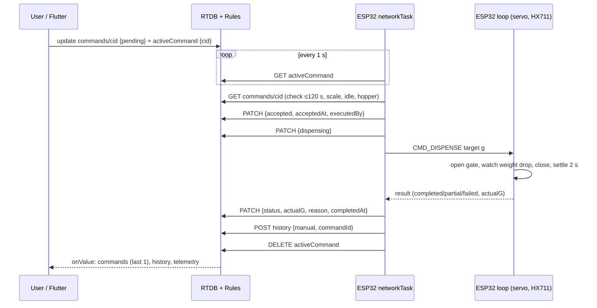
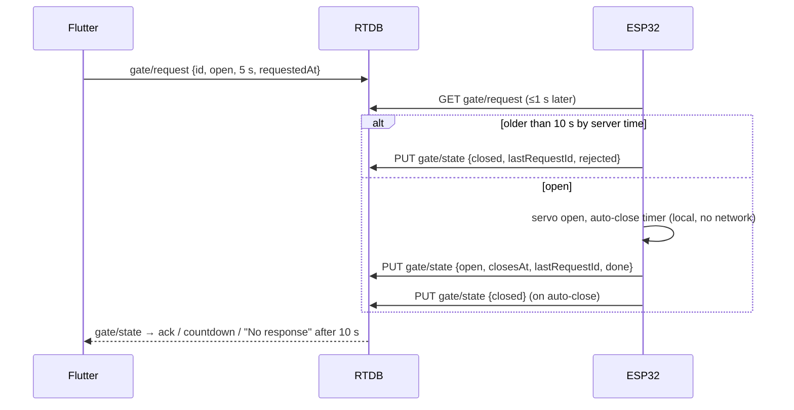

# Data-Flow Map

All feeder paths are under `feeders/{feederId}/`. `SV` = `{".sv":"timestamp"}` (server time; the rules require
`== now` for every device timestamp). Firmware = `AgriFeed_code.ino`; line numbers refer to it unless a file is named.

## 0. Architecture



## A. ESP32 → Firebase (writes)

All via `dbCall()` (l.649): `https://agrifeed-dda82-default-rtdb.firebaseio.com/feeders/<id>/<sub>.json?auth=<idToken>`,
TLS pinned to GTS Root R1/R4, connect timeout 8 s, read 6 s. Auth = Firebase ID token of the device's email/password account.
Expected response `200` + echoed JSON. `401` = rules refusal **or** expired token (if body contains "expired" → refresh now).
`<0` = network error → TLS connection dropped. No generic retry: periodic writes are simply repeated next cycle.

| Data | Path | Method | Payload | When | Error / retry | Firmware |
|---|---|---|---|---|---|---|
| Online + health + RSSI | `status` | PUT | `{lastSeen:SV, condition: ok/jam/low_feed/error/unknown, rssi, firmware:"esp32-2.0", source:"device"}` | first contact, every 5 s (1 s while busy) | repeated next cycle; response `lastSeen` sets device clock (`learnServerTime`) | `report()` l.823–845 |
| Hopper weight | `telemetry/current` | PUT | `{weightG:int ≥-500, measuredAt:SV, quality: ok/unstable, source}` | same as status, only if scale usable | repeated | l.848–855 |
| Weight log | `measurements` | POST | `{weightG, ts:SV, source}` | every 60 s | dropped on failure | `measure()` l.861 |
| Alerts | `alerts/{low_feed|stuck_feed|sensor_error}` | PATCH, then PUT on failure (new alert) | `{type, severity, state: active/resolved, lastAt:SV, source}` (+`firstAt:SV` on PUT) | on state change | retried next report until 200 (or 401 on resolve) | `writeAlert()` l.802 |
| Gate position | `gate/state` | PUT | `{position, reportedAt:SV, source, lastRequestId?, lastResult? done/rejected, reason?, closesAt?}` | boot, after each request, whenever position changes | repeated when position ≠ reported | `writeGateState()` l.871 |
| Feed-now progress | `commands/{cid}` | PATCH | `accepted`+`acceptedAt`+`executedBy:"device"` → `dispensing` → `completed/partial/failed` + `actualG` + `reason` + `completedAt` | per command | final report retried until 200 **or 401** | `pollCommand()` l.978, `reportJob()` l.1029 |
| Early reject/fail | `commands/{cid}` | PATCH | `{status: rejected/failed, reason, executedBy, completedAt}` | invalid/busy/empty/after restart | not retried | `finishCommandEarly()` l.966 |
| Lock release | `activeCommand` | DELETE | — | after result / orphan lock | not retried | l.974, 986, 999, 1042 |
| Feeding history | `history` | POST | `{method: manual/scheduled, requestedG, actualG?, status, ts:SV, source, commandId|scheduleId}` | after every feeding (incl. offline schedules) | queue of 10 in RAM (oldest dropped), flushed when online; **401 = dropped** | `recordHistory()` l.899, `flushHistory()` l.917 |
| Calibration | `config/calibrationStatus` | PUT | `"calibrated"` / `"uncalibrated"` | first contact | none | l.1230–1232 |

**Not written by the firmware:** calibration factor/offset (kept in flash only), `dispense_failed` alerts, `quality:"error"`, any timestamp other than server "now" (offline feedings are stamped with the *upload* time).

## B. Firebase → ESP32 (reads, all GET polling; no streaming)

| Data | Path | Interval | Validation / handling | Firmware |
|---|---|---|---|---|
| Last handled gate id | `gate/state/lastRequestId` | first contact | prevents re-running an old request after reboot | l.1229 |
| Time zone | `meta/timezone` | first contact + 60 s | mapped by `tzToPosix()` (8 names); others → `PHT-8` | l.733–757 |
| Config | `config` | first contact + 15 s | `lowThresholdG`, `schedulesPaused` cached in flash | `pollConfig()` l.759 |
| Schedules | `schedules` | first contact + 15 s | max 16; `time` "HH:MM", `amountG`, `enabled`, `weekdays` (object **or array** — RTDB returns `{"0":..}` as an array, verified); cached in flash; **deletions handled** (list replaced) | `pollSchedules()` l.773 |
| Gate request | `gate/request` | 1 s | new `id` only; rejected if server-age > 10 s or clock unknown; CLOSE always executed; OPEN refused while feeding; duration clamp 1–15 s | `pollGate()` l.934 |
| Feed-now lock | `activeCommand` | 1 s when idle | then `commands/{cid}` | `pollCommand()` l.978 |
| Command | `commands/{cid}` | with lock | `pending` + age ≤ 120 s + scale ok + idle + weight > 3 g; stale `accepted/dispensing` while idle ⇒ `failed` ("restarted"); finished ⇒ release lock; older than 120 s ⇒ left for the app to expire | l.983–1026 |

Execution of schedules: `checkSchedules()` (l.1066) every 1 s, exact HH:MM match, weekday bit, once per day per schedule (persisted `ranToday`), skipped when paused, clock invalid, **or another job is active**.

## C. Firebase → Flutter (listeners, `LiveValues` / `FirebaseFeederLive.watch`)

| Shown as | Path | Query | File | Notes |
|---|---|---|---|---|
| Weight, fill %, "Measured x ago" | `telemetry/current` | — | `home_tab.dart:33`, `feeding_tab.dart:39` | `quality` ignored |
| Online/offline, condition | `status` | — | same | online = `lastSeen` < 30 s old **by phone clock** (`feeder_live.dart:52,80`) |
| Capacity, threshold, max dispense, paused | `config` | — | same | defaults 2500/500/200 if missing |
| Gate state, countdown, ack | `gate/state` | — | `feeding_tab.dart:41` | ack = `lastRequestId == sentId`; "No response" after 10 s |
| Lock | `activeCommand` | — | `feeding_tab.dart:42` | |
| Command progress/result | `commands` | `orderByChild(requestedAt).limitToLast(1)` | `feeding_tab.dart:43` | index exists |
| Schedules | `schedules` | — | home + feeding | |
| History / Activity / 7-day bars | `history` | `orderByChild(ts).limitToLast(100/200)` | `activity_tab.dart:24`, `home_tab.dart:36` | index exists |
| Alerts | `alerts` | `orderByChild(lastAt).limitToLast(50)` | `feeder_repository.dart:66` | index exists |
| Feeder identity, mode | `meta`, `members/{uid}`, `userFeeders/{uid}` | — | `feeder_selection.dart` | |
| App connectivity | `.info/connected` | — | `feeder_selection.dart:154` | |
| `measurements` | — | — | — | **written by the device, never read by the app** |

## D. Flutter → Firebase (writes; all atomic `ref().update()` multi-path)

| Action | Paths | Payload | File:line | Rule |
|---|---|---|---|---|
| Feed now | `commands/{push}` + `activeCommand` | `{amountG, requestedBy:uid, requestedAt:SV, status:"pending", source:"app"}` + `{commandId, requestedAt:SV}` | `feeder_live.dart:323–336` | `manualFeed`, no lock, not archived |
| Give up (≥120 s pending) | `commands/{cid}/status="expired"`, `activeCommand=null` | | `feeder_live.dart:340` | requester/owner, server-age > 120 s |
| Gate | `gate/request` | `{id:push, action open/close, durationS 1–15, requestedAt:SV, requestedBy}` | `feeder_live.dart:346` | `manualFeed` |
| Schedule create/edit | `schedules/{sid}` | `{time, amountG, weekdays{"0".."6"}, enabled, createdAt, updatedAt:SV, updatedBy}` | `feeder_live.dart:360` | `manageSchedules` |
| Schedule enable/disable | same (full rewrite) | | `feeder_live.dart:382` | |
| Schedule delete | `schedules/{sid}=null` | | `feeder_live.dart:391` | |
| Pause/resume | `config/schedulesPaused` | bool | `feeding_tab.dart:641` | `manageSchedules` |
| Rename / time zone | `meta/name`, `meta/timezone` | | `feeder_repository.dart:81–86` | owner |
| Simulator values | `simulator/controls/*` | | `simulation_panel.dart:23`, `feeder_live.dart:395` | owner, simulated feeders only |
| Profile | `users/{uid}`, `displayName`, `lastSelectedFeederId` | | `profile_repository.dart`, `feeder_selection.dart:162` | own |
| Hopper capacity / threshold / max dispense | — | — | — | **no UI** (rules allow owner writes) |

## E. Sequences

### Manual feed


### Gate


### Schedule
```mermaid
sequenceDiagram
  participant U as Flutter
  participant DB as RTDB
  participant N as ESP32
  U->>DB: schedules/sid {07:30, 100 g, weekdays}
  N->>DB: GET schedules (≤15 s later) → flash cache
  Note over N: every 1 s: local time == 07:30 & weekday & not paused & idle & not run today
  N->>N: dispense (same as manual)
  N->>DB: POST history {scheduled, scheduleId} (queued if offline; ts = upload time)
  DB-->>U: Activity / Home history
```

### Connection monitoring
```mermaid
sequenceDiagram
  participant N as ESP32
  participant DB as RTDB
  participant U as Flutter
  loop every 5 s
    N->>DB: PUT status {lastSeen: SV}
  end
  U->>U: tick 1 s: now - lastSeen > 30 s → "offline", controls disabled
  Note over N: Wi-Fi lost → retry every 20 s; after 60 s also open portal "AgriFeed-Setup"
  N->>DB: on reconnect: re-sign-in if needed, first-contact sequence, flush queued history
```
